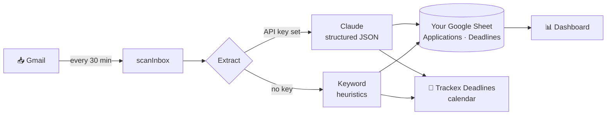

<div align="center">

<picture>
  <source media="(prefers-color-scheme: dark)" srcset="assets/logo-dark.svg">
  
</picture>

**Stop tracking job applications by hand.** Trackex reads your Gmail, keeps a live tracker of every<br>
job & internship application, and puts hackathon and assessment deadlines on your Google Calendar.

[](https://github.com/shloksrivastava2509/trackex/actions/workflows/ci.yml)
[](https://github.com/shloksrivastava2509/trackex/releases)
[](LICENSE)
[](https://developers.google.com/apps-script)

<a href="https://docs.google.com/spreadsheets/d/1qcuh3wWmPBe5nZuYhTvmzUwp-seUriVBQ3ZqtHWYJcc/copy"></a>

</div>

---

## Why Trackex

Applying to 50 internships means 50 confirmation emails, a dozen assessment links, interview invites
buried in threads, and hackathon deadlines you only remember the day after. Trackex turns your inbox
into the tracker — **you never add a row by hand.**

- 📥 **Fully automatic** — scans Gmail every 30 minutes and backfills the last 180 days on first run.
- 🧭 **Status that moves itself** — Applied → Under Review → Assessment → Interview → Offer / Rejected, updated as replies arrive (even in the same thread).
- 🔗 **Every link in one window** — each application has a one-click **Status portal** (Greenhouse, Lever, Workday, Ashby, …) and **Email** button.
- 📅 **Deadlines on your calendar** — hackathon registration & submission, online assessments, interviews and program deadlines go to a dedicated *Trackex Deadlines* calendar with reminders 3 days, 1 day and 2 hours before. Duplicate reminder emails never create duplicate events.
- 🧠 **Optional Claude extraction** — add an Anthropic API key and Trackex reads emails like a person would ("submissions close Friday 11:59pm ET"). Without a key it uses built-in keyword rules.
- 🔒 **Runs entirely in your Google account** — no server, no sign-up, nothing to host.

## What it looks like

<picture>
  <source media="(prefers-color-scheme: dark)" srcset="assets/dashboard-dark.png">
  
</picture>

<sub>Dashboard with sample data. It opens inside your sheet from <b>Trackex → Open dashboard</b>.</sub>

## Quick start

| | |
|---|---|
| **1. Copy** | Click **[Make a copy](https://docs.google.com/spreadsheets/d/1qcuh3wWmPBe5nZuYhTvmzUwp-seUriVBQ3ZqtHWYJcc/copy)** and confirm. You get your own private Trackex sheet. |
| **2. Start** | In your copy, open the **Trackex** menu → **▶ Start tracking**, and approve Google's permission prompt. |
| **3. (Optional)** | **Trackex → 🔑 Set Claude API key** with a key from [console.anthropic.com](https://console.anthropic.com), then **♻ Reset & rescan**. |

That's it. Trackex now runs every 30 minutes on its own. Open **Trackex → 📊 Open dashboard** any time.

> [!NOTE]
> Google will say **"Google hasn't verified this app"**. That's expected: Trackex is a script that runs
> as *you*, inside *your* account, and isn't a published Google product. Click **Advanced → Go to Trackex**.
> You can review the full source in [`src/`](src) before approving.

## How it works



| Problem | How Trackex handles it |
|---|---|
| Only read relevant mail | A Gmail search over job & hackathon keywords. Promotions is included, since Devpost and MLH emails often land there. |
| A rejection arrives as a reply in an old thread | Trackex remembers the last message it processed per thread, not a "done" label, so new replies are always read. |
| "Your application to Acme" with no role | Attached to your most recently active Acme application. |
| The backfill reads newest emails first | Status only changes from a *newer* email; a generic "still reviewing" note never demotes Interview → Under Review. |
| Five "48 hours left!" reminders | One calendar event, de-duplicated by organization + kind + day. |
| Finding the portal link | Claude must pick a URL that actually appears in the email (it can't invent one); the fallback scores links by ATS domain and link text. |

## Permissions & privacy

Trackex asks for these permissions on first run:

| Permission | Why |
|---|---|
| Gmail | Read job/hackathon emails and add the `Trackex` label to the ones it used. Trackex never sends, deletes or archives mail. |
| Google Calendar | Create the *Trackex Deadlines* calendar and its events. |
| Google Sheets | Store applications and deadlines in **this** spreadsheet. |
| External requests | Call `api.anthropic.com` — **only** if you set a Claude API key. |
| Triggers | Run the scan every 30 minutes. |

- All data stays in your Google account: your sheet, your calendar.
- Your API key is stored in Apps Script **user properties**: private to you and never copied with the sheet.
- Without a key, no email content leaves Google. With a key, each matched email is sent to Anthropic's API for extraction.
- To stop: **Trackex → ⏹ Stop tracking**. To remove access entirely: [Google Account → Third-party connections](https://myaccount.google.com/connections).

## Configuration

Settings live at the top of [`src/Config.gs`](src/Config.gs) (Extensions → Apps Script in your copy):

| Setting | Default | Meaning |
|---|---|---|
| `INITIAL_LOOKBACK_DAYS` | `180` | How far back the first scan reads |
| `INCREMENTAL_LOOKBACK_DAYS` | `7` | Window for each regular scan |
| `SCAN_EVERY_MINUTES` | `30` | Scan frequency (1, 5, 10, 15 or 30) |
| `SEARCH_TERMS` | job & hackathon keywords | Gmail search terms that select candidate threads |
| `REMINDERS_MIN` | `[4320, 1440, 120]` | Popup reminders before each event, in minutes |
| `CLAUDE_MODEL` | `claude-opus-5-5` | Model used for extraction. `claude-haiku-5-5` is ~40× cheaper. |
| `CALENDAR_NAME` | `Trackex Deadlines` | Calendar that receives deadlines |

## FAQ

<details>
<summary><b>The first scan says "more remaining". Is something wrong?</b></summary>

No. Apps Script stops any run after 6 minutes, so Trackex saves its progress and continues on the next
30-minute run. A large inbox can take a few runs to backfill; **Scan now** speeds it up.
</details>

<details>
<summary><b>An application has the wrong status or company.</b></summary>

Edit the row in the **Applications** tab; a newer email will still update it. The keyword fallback is decent
at statuses but weaker at company names and dates; setting a Claude API key fixes most misreads.
</details>

<details>
<summary><b>What does Claude extraction cost?</b></summary>

One API request per matched email. A typical inbox produces a few matches a day. Switch `CLAUDE_MODEL` to
`claude-haiku-5-5` in `Config.gs` for the cheapest option.
</details>

<details>
<summary><b>Can I get a bookmarkable dashboard URL?</b></summary>

Yes. In your copy, open Extensions → Apps Script → **Deploy → New deployment → Web app** with
*Execute as: Me* and *Who has access: Only myself*. The web-app URL serves the same dashboard.
</details>

<details>
<summary><b>How do I update to a new version?</b></summary>

Either make a fresh copy from the button above, or paste the `Code.gs` from the
[latest release](https://github.com/shloksrivastava2509/trackex/releases/latest) over your copy's code.
Your sheet data is untouched.
</details>

## Development

```bash
git clone https://github.com/shloksrivastava2509/trackex.git && cd trackex
npm ci
npm run check        # lint + tests + bundle
```

Push to **your own** copy of the sheet with [clasp](https://github.com/google/clasp): copy
`.clasp.json.example` to `.clasp.json`, set your copy's script ID, then `npx clasp login && npm run push`.
See [CONTRIBUTING.md](CONTRIBUTING.md) for details.

```
src/
├── Config.gs      settings, statuses, ATS domains
├── Scanner.gs     main loop: Gmail search → extract → store
├── Claude.gs      Claude structured-output extraction
├── Heuristics.gs  keyword fallback extractor
├── Store.gs       sheet persistence + status rules
├── Calendar.gs    calendar events + de-duplication
├── Menu.gs        the Trackex sheet menu
├── Setup.gs       start / stop / reset
├── WebApp.gs      dashboard data
└── Dashboard.html dashboard UI
```

## Contributing

Issues and PRs are welcome. Please read [CONTRIBUTING.md](CONTRIBUTING.md) and the
[Code of Conduct](CODE_OF_CONDUCT.md). Security issues: see [SECURITY.md](SECURITY.md).

## License

[MIT](LICENSE) © 2026 Shlok Srivastava
