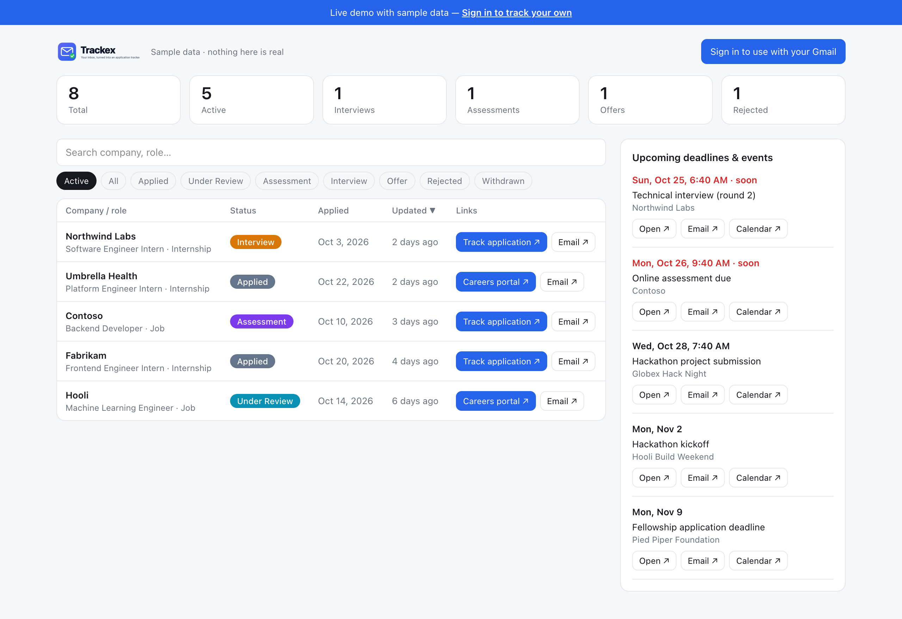
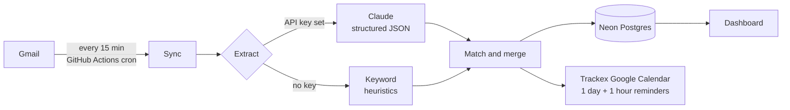

<div align="center">

<picture>
  <source media="(prefers-color-scheme: dark)" srcset="assets/logo-dark.svg">
  
</picture>

**Reads your Gmail so you don't have to.**
Tracks every job and internship application on its own
and puts hackathon deadlines on Google Calendar,
before you remember them a day late.

[](https://github.com/shloksrivastava2509/trackex/actions/workflows/ci.yml)
[](https://github.com/shloksrivastava2509/trackex/releases)
[](LICENSE)
[](https://nextjs.org)

<!-- TODO: replace with the real deployment URL -->
<a href="https://trackex.vercel.app/demo"></a>
<a href="docs/SETUP.md"></a>

</div>

---

## Why Trackex

Applying to 50 internships means 50 confirmation emails, a dozen assessment links, interview invites
buried in threads, and hackathon deadlines you only remember the day after. Trackex turns your inbox
into the tracker. **You sign in with Google once and never add a row by hand.**

## Features

- **Fully automatic.** Every 15 minutes Trackex reads new job, internship and hackathon emails. The first sync backfills the last 180 days (and continues across runs if needed).
- **Status that moves itself.** Applied, Under Review, Assessment, Interview, Offer, Rejected, Withdrawn. Status only moves forward, from newer emails.
- **Rejections find the right application.** Companies are normalised and roles matched fuzzily, so a differently worded rejection still lands on the right row. Duplicates are merged.
- **Every link in one window.** Each application links to the email's own "track your application" page (even when the link text is just "click here"), falling back to the candidate portal, then the careers site, plus the source email.
- **Deadlines on your calendar.** Interviews, assessments and assignments, and hackathon, registration, submission and application deadlines go into a dedicated **Trackex** Google Calendar at the exact time in your time zone.
- **Reminders that fire.** Popups 1 day and 1 hour before. All-day items remind at 9 AM and 6 PM the day before. Deadlines show as a 30-minute block ending at the deadline.
- **Optional Claude extraction.** With an Anthropic API key, emails are read like a person would. Without one, built-in keyword rules take over.
- **Dashboard.** Stats, search and filters, "Track application", "Careers portal", "Email" and "Calendar" links, upcoming events, **Sync now**, and **Disconnect & delete data**.
- **Public demo.** [`/demo`](https://trackex.vercel.app/demo) shows sample data with no login.

## What it looks like

<picture>
  <source media="(prefers-color-scheme: dark)" srcset="assets/dashboard-dark.png">
  
</picture>

<sub>Dashboard with sample data.</sub>

## How it works



| Problem | How Trackex handles it |
|---|---|
| Only read relevant mail | A Gmail search filter over job, internship and hackathon mail. |
| Never extract an email twice | Incremental syncs use Gmail's `after:` query plus a processed-message table. |
| Rejection worded differently | Company normalisation and fuzzy role matching update your existing row. |
| Status regressions | Status only moves forward from newer emails. |
| Finding the status link | The email's own "track your application" link wins, then the candidate portal, then the careers site. |
| Duplicate reminders | Duplicate applications are merged and events are not re-created. |

## Privacy & permissions

| Permission | Why |
|---|---|
| `gmail.readonly` | Read job and hackathon emails. Trackex never sends, deletes or labels mail. |
| `calendar.app.created` | Create and manage only the calendar Trackex creates. It cannot touch your other calendars. |
| `openid`, `email`, `profile` | Sign you in. |

- Google refresh tokens are encrypted at rest with AES-256-GCM.
- Email bodies are **not stored**, only application and event metadata.
- Claude sees email content only if an API key is configured.
- **Disconnect & delete data** removes the Trackex calendar, revokes Google access and deletes all your rows.
- See the in-app [`/privacy`](app/privacy/page.tsx) page and [SECURITY.md](SECURITY.md).

## Self-hosting in 15 minutes

You need free accounts on Neon, Google Cloud, Vercel and GitHub. The full, numbered guide is in **[docs/SETUP.md](docs/SETUP.md)**. In short:

1. Fork the repo and create a Neon database (`npm run db:push`).
2. Create a Google Cloud OAuth client with the Gmail and Calendar APIs enabled, and **publish** the consent screen.
3. Deploy to Vercel with the environment variables from [`.env.example`](.env.example).
4. Add `APP_URL` and `CRON_SECRET` as GitHub Actions secrets so the 15-minute sync runs.

## Tech stack

| Layer | Choice |
|---|---|
| App | Next.js 16 (App Router), React 19, TypeScript, Tailwind v4 |
| Auth | Auth.js v5 (Google, offline access, JWT sessions) |
| Data | Neon Postgres with Drizzle ORM |
| Extraction | Anthropic Claude (`CLAUDE_MODEL`, default `claude-opus-5-5`), structured JSON, up to 8 emails in parallel; keyword-rule fallback |
| Google APIs | Plain `fetch` against the REST APIs (no `googleapis` package) |
| Hosting | Vercel free plan |
| Background sync | GitHub Actions (`.github/workflows/sync.yml`) |
| Tests | Vitest |

## Project structure

```
app/                  Next.js routes: landing, dashboard, demo, privacy, api/
├── api/              auth, cron, sync, timezone, account/delete
components/           Dashboard UI and shared components
lib/
├── extract/          Claude extraction, keyword heuristics, link handling
├── match.ts          company normalisation, fuzzy matching, merging
├── sync.ts           per-user sync loop
├── gmail.ts          Gmail REST client
├── calendar.ts       Trackex calendar and events
├── google.ts         OAuth token refresh and fetch helper
├── crypto.ts         AES-256-GCM token encryption
└── db/               Drizzle schema and client
test/v2/              Vitest suites
docs/SETUP.md         Owner setup guide
```

## Development

```bash
git clone https://github.com/shloksrivastava2509/trackex.git && cd trackex
npm ci
cp .env.example .env.local   # fill in, see docs/SETUP.md
npm run db:push              # create tables
npm run dev                  # http://localhost:3000
```

| Command | What it does |
|---|---|
| `npm run dev` | Start the dev server |
| `npm run check` | Lint, typecheck and tests |
| `npm run build` | Production build |
| `npm run db:push` | Push the schema to your database |

## Limitations

- **100-user cap.** Trackex is a personal project, so Google shows an "unverified app" screen once (Advanced, then Go to Trackex) and limits unverified apps to 100 users.
- **Restricted scope.** Gmail is a restricted scope. Unlimited public use would need Google verification and a paid CASA security assessment, which is out of scope.
- **15-minute granularity.** Sync runs every 15 minutes via GitHub Actions. Scheduled workflows pause after 60 days of repo inactivity.

## Looking for v1 (Google Sheets)?

v1.0.0 to v1.2.0 were a Google Apps Script bound to a copied Google Sheet. They are no longer maintained, but the releases remain on [GitHub](https://github.com/shloksrivastava2509/trackex/releases).

## Contributing

Issues and PRs are welcome. Please read [CONTRIBUTING.md](CONTRIBUTING.md) and the
[Code of Conduct](CODE_OF_CONDUCT.md). Security issues: see [SECURITY.md](SECURITY.md).

## License

[MIT](LICENSE) © 2026 Shlok Srivastava
